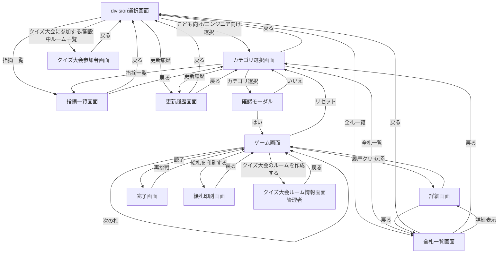

# かるた読み上げ

## 目的
かるたの読み上げをアプリで行うことで、全員がかるたに参加すること。

## Features

- **フレーズ読み上げ**:
  - 指定されたカテゴリのフレーズをランダムに取得し、Amazon Pollyを利用して音声を生成します。
  - 英語と日本語に対応しており、読み上げ速度の調整が可能です。
  - 読み上げ回数や平均タイム、平均難易度を記録します。
- **カテゴリ管理**:
  - 登録されているフレーズのカテゴリを一覧で取得します。
- **コメント機能**:
  - 各フレーズに対してコメントを投稿し、表示できます。
- **お祝いメッセージ**:
  - 全てのフレーズを読み終えると、お祝いのメッセージが音声で再生されます。
- **フレーズ一覧**:
  - 登録されているフレーズを一覧で確認できます。
- **クイズ大会モード**:
  - 管理者がルームを開設し、ルームコードまたはQRコードで参加者を招待できます。
  - WebSocketにより、読み札・結果画面が管理者・参加者間でリアルタイムに同期されます（読み上げ音声は参加者の端末でも再生されます）。
  - 早押しに対応しており、最初に回答した参加者だけが確定し、管理者が正誤を判定します。
  - 正誤判定に応じてポイントが集計され、参加者一覧とあわせて表示されます。

## Tech Stack

使用技術の一覧は[Tech Stack](docs/tech-stack.md)を参照してください。

## Architecture

自動生成ドキュメントの一覧は[docs/generated/README.md](docs/generated/README.md)を参照してください。以下はその一部を個別に示したもの。

### System Architecture

`backend/serverless.yml`の実際の定義から自動生成されるサーバレス構成図（関数単位のリソース依存関係、issue #919）を参照: [docs/generated/serverless-architecture.md](docs/generated/serverless-architecture.md)

### Screen Transitions

ソースを表示（mermaid記法）

同様に、上記図もCIが再レンダリングし`docs-diagrams`ブランチの`latest/`へ公開している画像。

### Backend API (AWS Lambda)

`backend/serverless.yml`のhttpApiイベント定義から自動生成されるBackend API仕様書（issue #919）を参照: [docs/generated/backend-api.md](docs/generated/backend-api.md)

### WebSocket API（クイズ大会モード）

読み札・結果画面の同期や早押し判定など、クイズ大会モードのリアルタイム通信はAPI Gateway WebSocket API（`quizRoomHandler.js`）で行う。ルート一覧・代表的な通信フローは自動生成されるWebSocket API仕様書（issue #919）を参照: [docs/generated/websocket-api.md](docs/generated/websocket-api.md)

### Database (DynamoDB)

`backend/serverless.yml`の`AWS::DynamoDB::Table`リソース定義から自動生成されるDynamoDBテーブル定義書（issue #919）を参照: [docs/generated/dynamodb-tables.md](docs/generated/dynamodb-tables.md)

## CI/CD Pipeline Specification

詳細な CI/CD パイプラインの仕様については、[CI/CD Pipeline Specification](docs/cicd-pipeline-specification.md) を参照してください。

本番デプロイへのブルーグリーン（カナリア）方式導入（issue #1319）に伴い、単一ステージ運用からstable/canary構成へ移行した（完了済み）。移行記録・karuta固有の実装詳細は[単一ステージ運用からstable/canaryへの移行記録](docs/blue-green-stage-migration.md) を、パターン自体の一般的な仕組みは[dev-standards/docs/blue-green-stage-pattern.md](https://github.com/bamiyanapp/dev-standards/blob/main/docs/blue-green-stage-pattern.md)を参照してください。

`stable`・`canary`は共存期間中、同一DynamoDBテーブルを共有する。このためのスキーマ変更の開発規律については、[stable/canary共存中のDynamoDBスキーマ互換性ガイドライン](docs/dynamodb-schema-compatibility-canary.md) を参照してください。

現在のcanary運用状態（重み・ロールバック状態・反映待ちPR一覧等）は、`canary-status.yml`が1日1回自動更新する[canary運用状態](docs/generated/canary-status.md)を参照してください。

## 運用

クイズ大会モードの運用手順、バックアップと復旧、かるた情報（フレーズ等）の追加・更新手順については、[運用](docs/operations.md)を参照してください。